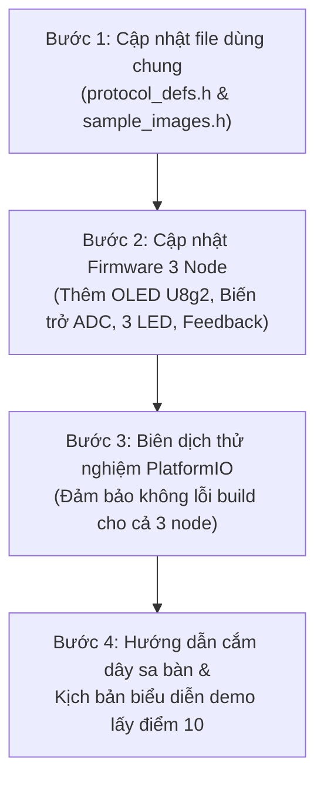

# KẾ HOẠCH CHI TIẾT TRIỂN KHAI HỆ THỐNG TRUYỀN THÔNG TIN TỰ THÍCH NGHI (ADAPTIVE)
## Đề tài: Hệ thống truyền ảnh Bitmap 64x64 qua Kênh Nhiễu trên 3x ESP32-C3 SuperMini
> **Mục tiêu:** Đạt điểm 10 tuyệt đối (30% điểm quá trình) môn Lý thuyết Thông tin & Truyền thông thông qua sa bàn demo phần cứng độc lập, trực quan hóa theo thời gian thực và cơ chế mã hóa tự thích nghi.

---

## I. TỔNG QUAN KIẾN TRÚC & ĐIỂM NHẤN CÔNG NGHỆ ("SHOW-OFF")

### 1. Kiến trúc Shannon 3 khối chuẩn mực
* **Máy phát (Node 1 - Tx):** Nguồn ảnh Bitmap 64x64 $\to$ Nén nguồn (Huffman) $\to$ Mã hóa kênh tự thích nghi (Direct / Hamming / Cyclic) $\to$ Đóng gói khung $\to$ UART TX.
* **Kênh truyền (Node 2 - Channel):** Nhận UART $\to$ Đọc giá trị biến trở (ADC) để xác định xác suất nhiễu $P_e$ $\to$ Đảo bit giả lập nhiễu vật lý BSC $\to$ Chuyển tiếp UART RX. Đồng thời chuyển tiếp ngược luồng Feedback từ Rx về Tx.
* **Máy thu (Node 3 - Rx):** Nhận UART $\to$ Giải mã kênh hệ thống (Syndrome decoding, sửa lỗi) $\to$ Giải nén nguồn $\to$ Ghép vào framebuffer tái tạo ảnh $\to$ Đo lường BER thực tế $\to$ **Gửi Feedback ngược qua Kênh về Máy phát** $\to$ Điều khiển 3 LED chỉ thị mode.

### 2. Ba điểm nhấn kỹ thuật "ăn điểm tuyệt đối"
1. **Sa bàn phần cứng hoạt động độc lập 100% (Stand-alone):** Không cần cắm máy tính khi demo. Giảng viên nhìn trực tiếp trên 3 màn hình OLED SSD1306 I2C:
   * **OLED 1 (Tx):** Ảnh gốc 64x64 + Kích thước sau nén + Mode đang phát.
   * **OLED 2 (Kênh):** Thanh đo mức nhiễu thời gian thực (%) + Tỷ lệ đảo bit (điều khiển xoay bằng biến trở).
   * **OLED 3 (Rx):** Ảnh tái tạo sau giải mã sửa lỗi + Chỉ số BER, số bit đã sửa thành công.
2. **Cơ chế Mã hóa Kênh Tự thích nghi (Adaptive Channel Coding) với Hysteresis:**
   * *Nhiễu thấp ($BER < 1\%$):* Chế độ **Direct** (Bypass/Mã nhẹ), LED Xanh sáng, tối ưu thông lượng đường truyền.
   * *Nhiễu trung bình ($1\% \le BER \le 4\%$):* Chế độ **Hamming (7,4)**, LED Vàng sáng, phát hiện và sửa lỗi 1-bit mỗi block.
   * *Nhiễu cao ($BER > 4\%$):* Chế độ **Cyclic (7,4)** với $g(x) = x^3 + x + 1$, LED Đỏ sáng, kích hoạt kiểm tra và khôi phục chuỗi.
3. **Luồng phản hồi (Feedback) hợp lệ tuyệt đối:**
   * Tín hiệu báo mức kênh từ Máy thu được gửi **xuyên qua Kênh** về Máy phát (Kênh đóng vai trò môi trường truyền 2 chiều), hoàn toàn không vi phạm mô hình 3 khối bắt buộc của đề bài.

---

## II. DANH MỤC PHẦN CỨNG CHÍNH THỨC (ĐÃ LOẠI BỎ CÁC PHẦN PHỤ)

Hệ thống chỉ sử dụng các linh kiện thực tế cần thiết, không dùng bất kỳ module phụ không dây nào (không dùng LoRa):

| STT | Thiết bị / Linh kiện | Số lượng | Vai trò cụ thể |
|:---:|:---|:---:|:---|
| **1** | **ESP32-C3 Super Mini (TENSTAR ROBOT)** | **3 mạch** | Vi điều khiển độc lập cho 3 khối: Máy phát – Kênh – Máy thu |
| **2** | **Màn hình OLED SSD1306 (I2C, 4 chân)** | **3 màn** | Hiển thị ảnh phát, thanh đo mức nhiễu kênh và ảnh thu sau sửa lỗi |
| **3** | **Biến trở xoay (Potentiometer) 10kΩ** | **1 chiếc** | Chỉnh xác suất lỗi bit vật lý thời gian thực qua chân ADC Kênh |
| **4** | **Đèn LED chỉ thị Mode (Xanh, Vàng, Đỏ)** | **3 chiếc** | Nối Máy thu (GPIO 6, 7, 10) báo 3 chế độ mã hóa tự thích nghi |
| **5** | **Điện trở $220\Omega - 330\Omega$** | **3 chiếc** | Hạn dòng bảo vệ 3 LED |
| **6** | **Nút nhấn (Push button)** | **1 chiếc** | Nối Máy phát (GPIO 10) để bấm chuyển đổi ảnh mẫu demo |
| **7** | **Tấm phíp đồng đục lỗ (Protoboard)** | **1 tấm** | Hàn rào cắm và ráp cố định toàn bộ 3 khối thành sa bàn hoàn chỉnh |
| **8** | **Dây câu, rào cắm cái (Female header 8-pin)** | **1 bộ** | Cắm rút ESP32-C3 và cấp nguồn bus chung (5V/3.3V/GND) |

---

## III. ĐẶC TẢ GIAO THỨC & CẤU TRÚC DỮ LIỆU (`shared/protocol_defs.h`)

### 1. Phân loại loại khung (Frame Type)
```c
typedef enum {
    FRAME_TYPE_DATA        = 0x01, /* Khung truyền dữ liệu ảnh từ Tx sang Rx */
    FRAME_TYPE_FEEDBACK    = 0x02  /* Khung phản hồi trạng thái từ Rx về Tx */
} frame_type_t;
```

### 2. Định dạng khung dữ liệu ảnh (Forward Frame)
Mỗi ảnh 64x64 có kích thước $64 \times 64 / 8 = 512$ bytes. Được chia làm 4 block (mỗi block 128 bytes - 16 dòng quét) hoặc 8 block (64 bytes):
```
┌──────┬────────────┬────────┬──────────┬──────────┬──────────┬─────────────────┬────────┬──────┐
│ SOF  │ FRAME_TYPE │ PKT_ID │ CHN_MODE │ SRC_ALG  │ PAYLOAD  │ ECC/PARITY BITS │ CRC16  │ EOF  │
│ 0x7E │    0x01    │ 1 Byte │  1 Byte  │  1 Byte  │ N Bytes  │     M Bytes     │ 2 Byte │ 0x7F │
└──────┴────────────┴────────┴──────────┴──────────┴──────────┴─────────────────┴────────┴──────┘
```
* **PKT_ID (0..3):** Thứ tự mảnh ảnh giúp Rx ghép đúng vị trí trên màn hình OLED.
* **CHN_MODE:** `0x00` (Direct), `0x01` (Hamming 8,4/7,4), `0x02` (Cyclic 7,4).
* **PAYLOAD:** Dữ liệu sau khi nén Huffman (hoặc raw chunk nếu nén không giảm kích thước).
* **ECC/PARITY:** Các bit kiểm tra được tính toán theo thuật toán kênh tương ứng.

### 3. Định dạng khung phản hồi thích nghi (Feedback Frame)
```
┌──────┬────────────┬──────────────┬─────────────────┬──────────────────┬────────┬──────┐
│ SOF  │ FRAME_TYPE │ MEASURED_BER │ CORRECTED_BITS  │ RECOMMENDED_MODE │ CRC16  │ EOF  │
│ 0x7E │    0x02    │ 1 Byte (%)   │ 2 Bytes (Count) │      1 Byte      │ 2 Byte │ 0x7F │
└──────┴────────────┴──────────────┴─────────────────┴──────────────────┴────────┴──────┘
```

---

## III. CHI TIẾT CÁC CÔNG VIỆC CẦN LÀM CHO TỪNG BO MẠCH

### 1. Bo mạch Máy phát (Node 1 - Tx)
* **File cần chỉnh sửa/tạo:**
  * `01_transmitter/platformio.ini`: Thêm thư viện `olikraus/U8g2` để điều khiển màn OLED SSD1306 I2C.
  * `01_transmitter/include/sample_images.h` (Tạo mới): Chứa 2-3 mảng ảnh Bitmap 64x64 chuẩn bị sẵn trong `PROGMEM` (icon mặt cười, logo, mã QR nhỏ).
  * `01_transmitter/include/tx_config.h`: Cấu hình chân I2C (SDA: GPIO 8, SCL: GPIO 9), UART TX (GPIO 21), UART RX nhận feedback (GPIO 20).
  * `01_transmitter/src/main.cpp`:
    * Thêm tác vụ khởi động màn OLED và hiển thị ảnh gốc 64x64 ở nửa bên trái màn hình (tọa độ x:0, y:0).
    * Cập nhật máy trạng thái (State Machine): Lắng nghe gói `FRAME_TYPE_FEEDBACK` từ UART RX. Khi nhận khuyến nghị mode mới, tự động đổi `g_tx_settings.chn_alg` cho các khung tiếp theo.
    * Đóng gói ảnh thành các block, nén Huffman, mã hóa kênh và gửi định kỳ qua UART TX.

### 2. Bo mạch Kênh truyền (Node 2 - Channel)
* **File cần chỉnh sửa/tạo:**
  * `02_channel/platformio.ini`: Thêm thư viện `olikraus/U8g2`.
  * `02_channel/include/channel_config.h`:
    * Định nghĩa chân ADC đọc biến trở: `PIN_POTENTIOMETER = GPIO 0`.
    * Cấu hình 2 cổng UART:
      * `UART0` (Pins 20 RX, 21 TX): Kết nối với Máy phát (Tx).
      * `UART1` (Pins 6 RX, 7 TX): Kết nối với Máy thu (Rx).
  * `02_channel/src/main.cpp`:
    * **Đọc biến trở & lọc số (ADC Filter):** Đọc ADC trên GPIO 0, áp dụng bộ lọc trung bình trượt 16 mẫu để loại bỏ rung lắc điện áp, ánh xạ tuyến tính dải $0 - 4095 \to BER = 0.0\% - 15.0\%$.
    * **Định tuyến 2 chiều:**
      * Chiều xuôi (Tx $\to$ Rx): Bắt khung dữ liệu, áp dụng hàm đảo bit `apply_noise()` trên Payload & ECC theo tỷ lệ BER đã chỉnh, rồi đẩy sang Rx qua UART1.
      * Chiều ngược (Rx $\to$ Tx): Nhận khung Feedback từ UART1 và forward nguyên vẹn sang UART0 về Tx (kênh lý tưởng cho đường phản hồi).
    * **Hiển thị OLED 2:** Vẽ thanh đo tiến trình (Progress Bar) mức BER $0\% - 15\%$ và hiển thị text tỷ lệ lỗi bit thực tế.

### 3. Bo mạch Máy thu (Node 3 - Rx)
* **File cần chỉnh sửa/tạo:**
  * `03_receiver/platformio.ini`: Thêm thư viện `olikraus/U8g2`.
  * `03_receiver/include/rx_config.h`:
    * Cấu hình chân LED: `PIN_LED_GREEN = GPIO 10`, `PIN_LED_YELLOW = GPIO 4`, `PIN_LED_RED = GPIO 5`.
    * Cấu hình chân OLED I2C (SDA: GPIO 8, SCL: GPIO 9).
    * Cấu hình chân UART: RX (GPIO 20), TX gửi feedback (GPIO 21).
  * `03_receiver/src/main.cpp`:
    * Nhận khung dữ liệu $\to$ Giải mã kênh Hamming/Cyclic $\to$ Sửa lỗi 1-bit $\to$ Giải nén Huffman $\to$ Copy block dữ liệu vào mảng Framebuffer ảnh tái tạo `uint8_t rx_image_buf[512]`.
    * **Bộ đánh giá & Thuật toán Adaptive (Hysteresis):**
      * Đếm số bit đã sửa và số khung lỗi CRC.
      * Nếu kênh không có lỗi trong 5 khung liên tiếp $\to$ Đề xuất mode `DIRECT`.
      * Nếu có 1 lỗi bit trên block $\to$ Đề xuất mode `HAMMING`.
      * Nếu xuất hiện lỗi kép không sửa được hoặc CRC fail $\to$ Đề xuất mode `CYCLIC`.
      * Đóng gói `FRAME_TYPE_FEEDBACK` và phát ngược lại sang Kênh qua UART TX.
    * **Điều khiển LED trạng thái:** Bật đúng 1 trong 3 đèn LED theo Mode hiện tại của hệ thống.
    * **Hiển thị OLED 3:** Vẽ ảnh tái tạo 64x64 ở nửa bên trái màn hình; nửa bên phải hiển thị Mode, số bit đã sửa (`Fix: xx`), và BER đo được.

---

## V. SƠ ĐỒ ĐẤU NỐI PHẦN CỨNG CHI TIẾT (WIRING & PINOUT)

```
========================================================================================
                          SƠ ĐỒ TOÀN BỘ SA BÀN MẠCH PHẲNG
========================================================================================

  +-------------------+       +-----------------------+       +-------------------+
  |   MÁY PHÁT (Tx)   |       |   KÊNH TRUYỀN (Ch)    |       |   MÁY THU (Rx)    |
  |  [ESP32-C3 Mini]  |       |    [ESP32-C3 Mini]    |       |  [ESP32-C3 Mini]  |
  |                   |       |                       |       |                   |
  | OLED 1 (Ảnh gốc)  |       | OLED 2 (Mức nhiễu %)  |       | OLED 3 (Ảnh nhận) |
  | SDA: 8 | SCL: 9   |       | SDA: 8 | SCL: 9       |       | SDA: 8 | SCL: 9   |
  |                   |       |                       |       |                   |
  | Nút bấm: GPIO 10  |       | Biến trở 10k: GPIO 0  |       | LED Xanh : GPIO 6 |
  |                   |       |                       |       | LED Vàng : GPIO 7 |
  |                   |       |                       |       | LED Đỏ   : GPIO 10|
  |                   |       |                       |       |                   |
  | TX (21) ──────────┼──────>│ RX0 (20)              |       |                   |
  |                   |       | TX1 (5)  ─────────────┼──────>│ RX (20)           |
  |                   |       |                       |       |                   |
  | RX (20) <─────────┼───────│ TX0 (21)              |       |                   |
  |                   |       | RX1 (4)  <────────────┼───────│ TX (21)           |
  +-------------------+       +-----------------------+       +-------------------+
            │                             │                             │
            └─────────────────────────────┴─────────────────────────────┘
                             NGUỒN CHUNG: 5V/3.3V & GND CHUNG
```

---

## V. LỘ TRÌNH 4 BƯỚC THỰC THI (ACTION ROADMAP)



1. **Bước 1:** Cập nhật `shared/protocol_defs.h` và tạo file mảng ảnh `shared/sample_images.h` (Ảnh Bitmap 64x64).
2. **Bước 2:** Cập nhật PlatformIO (`platformio.ini`) và mã nguồn C++ của cả 3 node (`01_transmitter`, `02_channel`, `03_receiver`) để tích hợp U8g2, ADC biến trở, LED và vòng lặp feedback thích nghi.
3. **Bước 3:** Chạy biên dịch kiểm tra (`pio run`) độc lập cho từng node trong thư mục `out/esp32_c3_comm_system/` để đảm bảo code compile sạch sẽ 100%, không xung đột bộ nhớ hay trùng chân GPIO.
4. **Bước 4:** Lập tài liệu hướng dẫn đấu nối sa bàn thực tế trên phíp đồng và kịch bản thuyết trình trực quan trước giảng viên.

---

## VI. XÁC NHẬN TRƯỚC KHI THỰC HIỆN

Tuân thủ **Quy tắc số 2 trong RULE.txt** (*Luôn lên kế hoạch trước khi làm, phải hỏi tôi trước khi thực hiện*):

👉 **Tôi đã chuẩn bị đầy đủ mã nguồn và kiến trúc chi tiết như trên. Bạn có đồng ý để tôi bắt đầu thực hiện BƯỚC 1 (Cập nhật `protocol_defs.h` và tạo `sample_images.h`) không?**
